<div align="center">

# 🚀 Smart Placement Platform

### An AI-Powered Campus Placement Platform

<p>
  <strong>Discover • Apply • Manage • Prepare • Get Placed</strong>
</p>

<p>
  
  
  
  
  
</p>

<p>
  <a href="#-features">Features</a> •
  <a href="#-screenshots">Screenshots</a> •
  <a href="#-architecture">Architecture</a> •
  <a href="#-installation">Installation</a> •
  <a href="#-roadmap">Roadmap</a>
</p>

</div>

---

## 📖 About The Project

**Smart Placement Platform** is a Java Full Stack web application that organizes the entire campus placement journey in one place.

Students can build profiles, explore eligible jobs, apply, track applications, build resumes and practice interviews. Recruiters can publish openings and manage applicants. Administrators oversee platform access.

The application uses a **React + Vite** frontend, a **Spring Boot REST API**, and a **MySQL** database. Authentication is handled with **JWT**, and passwords are protected with **BCrypt**.

---

## 🎯 Problem Statement

Campus placements are often managed through scattered spreadsheets, emails and messaging groups. Students miss opportunities they are eligible for, recruiters struggle to filter candidates, and nobody has a single view of application status.

Interview preparation is also disconnected from the placement process itself.

---

## 💡 Solution

Smart Placement Platform provides one role-aware platform where every participant has a dedicated workspace.

```text
Student                    Recruiter                  Admin
  │                           │                         │
  ├── Build Profile           ├── Company Profile       ├── Manage Users
  ├── Browse Jobs             ├── Post Jobs             └── Platform Oversight
  ├── Apply                   ├── Review Applicants
  ├── Track Status            └── Update Status
  ├── Resume Builder
  └── AI Interview Coach
            │                           │
            └────────────┬──────────────┘
                         ▼
              Smart Placement Platform
```

---

## ✨ Features

### 👨‍🎓 Student Workspace

- Profile with education, CGPA, skills and graduation details
- Browse jobs and check eligibility
- Apply for jobs and track application status
- Resume builder and resume-to-job matching
- Job recommendations based on profile information

### 🏢 Recruiter Workspace

- Recruiter / company profile
- Post and manage job openings
- Review applications and candidate information
- Update application status

### 🤖 AI Interview Assistance

- Generate interview practice questions
- Practice Java Full Stack topics
- AI chat-style interview coach (requires an AI provider key)

### 🔐 Authentication & Security

- JWT-based authentication
- BCrypt password hashing
- Role-Based Access Control (RBAC)
- Separate access for `STUDENT`, `RECRUITER` and `ADMIN`

### Application Status Workflow

```text
Student
  │
  │ Apply for Job
  ▼
APPLIED
  │
  ▼
Recruiter Reviews
  │
  ├───────────────┐
  ▼               ▼
SHORTLISTED     REJECTED
  │
  ▼
SELECTED
```

> ⚠️ Adjust the status names above to match the exact values used in your backend.

---

## 👥 Roles & Access

| Role | Intended Access |
|------|-----------------|
| 👨‍🎓 `STUDENT` | Profile, job discovery, applications, resume tools, interview practice |
| 🏢 `RECRUITER` | Recruiter profile, job posting, applicant management |
| 🛡️ `ADMIN` | Administrative operations and platform oversight |

RBAC is enforced by the backend. Hiding a button in the frontend is not security.

---

## 📸 Screenshots

Add real screenshots of the running application to `docs/screenshots/` using the filenames below.

### 🔐 Login


### 📊 Student Dashboard

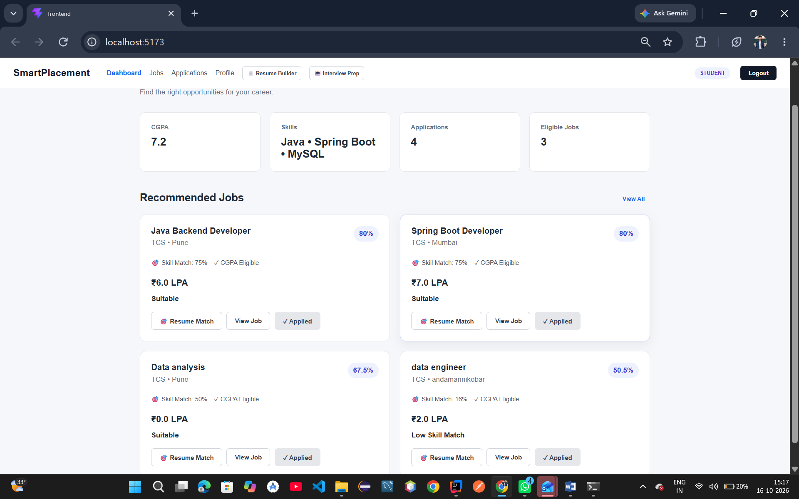

### 📊 Student JOB Recommendation

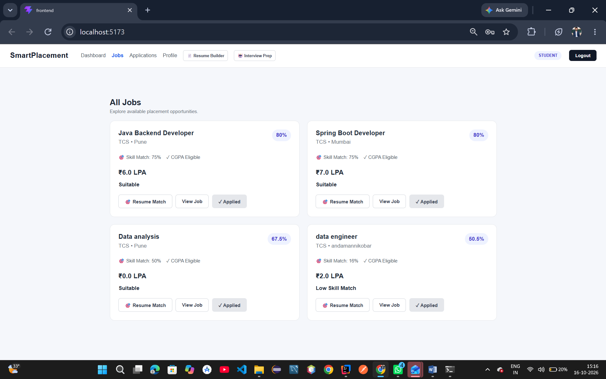

### 📊 Student Application

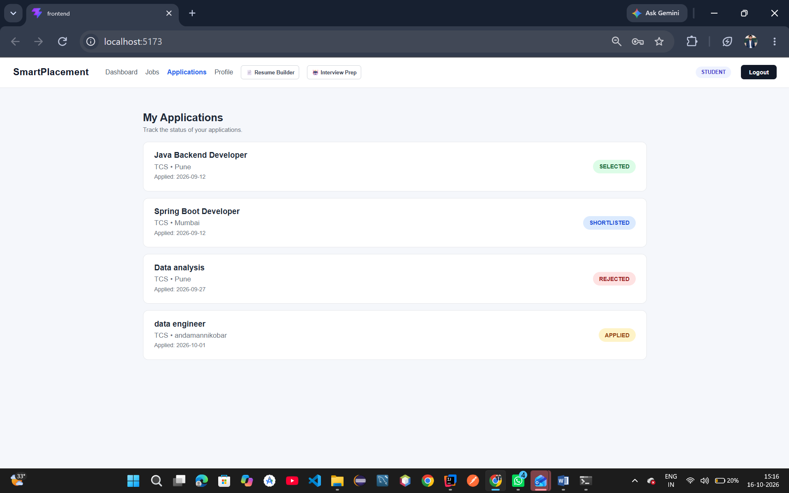

### 📊 Skill Match/Recommendation Score

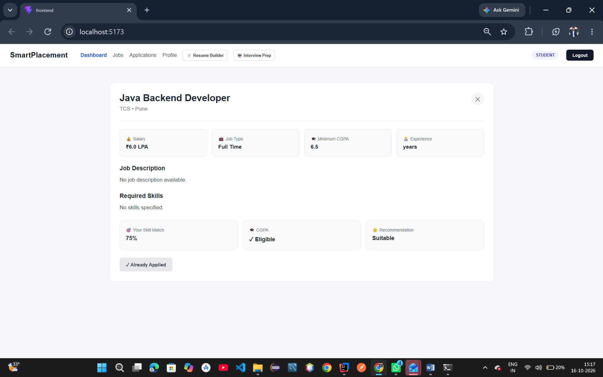

### 📊 Student Profile

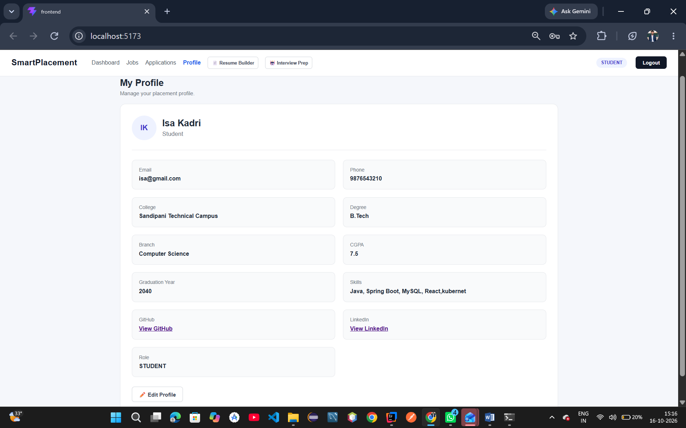

### 📊 Resume Builder

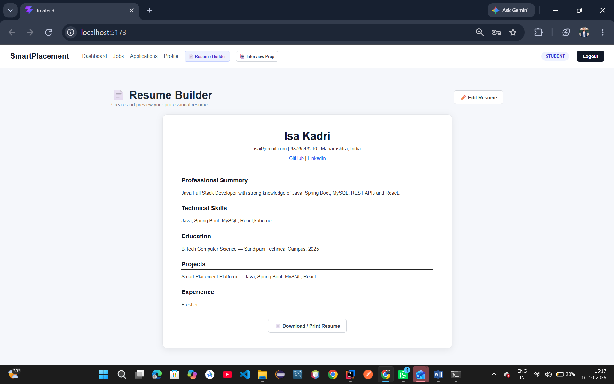

### 🤖 AI Interview Coach

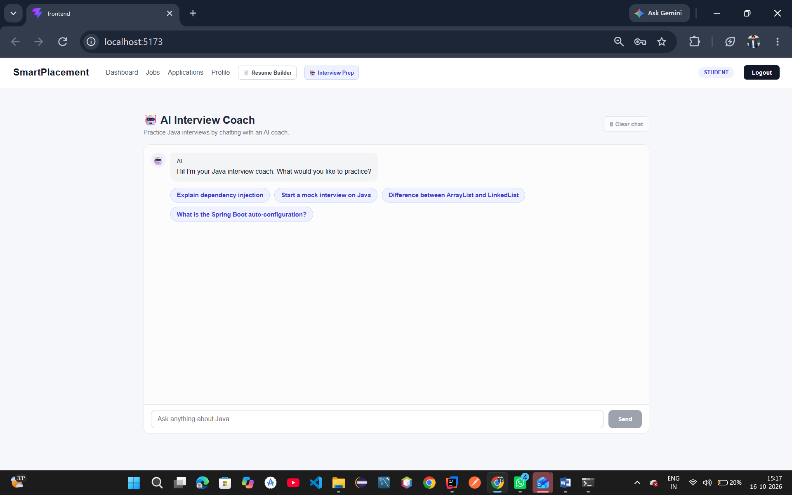

### 🏢 Recruiter Dashboard

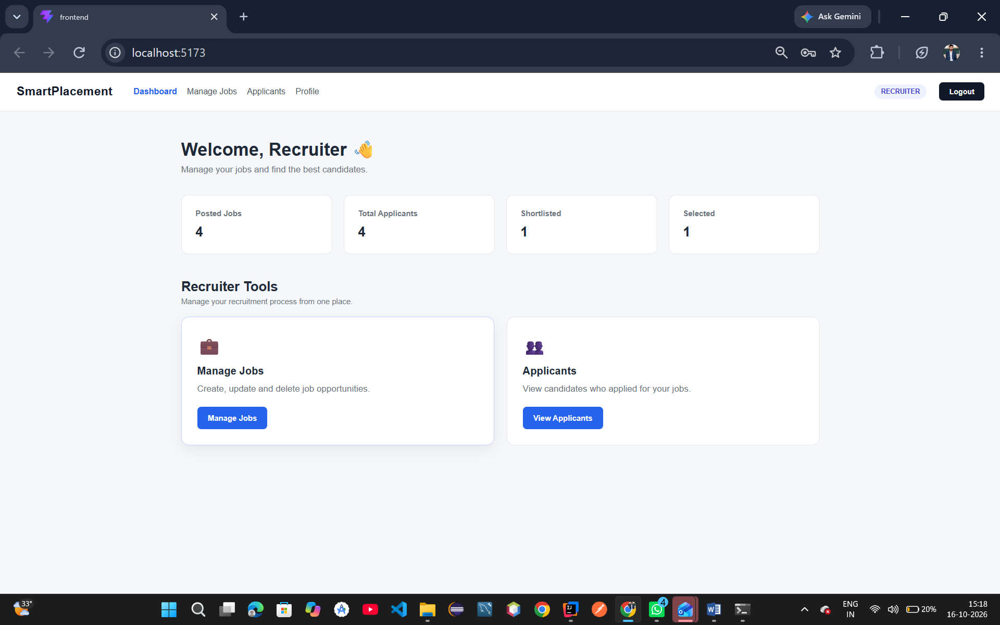


### 🏢 Recruiter Profile

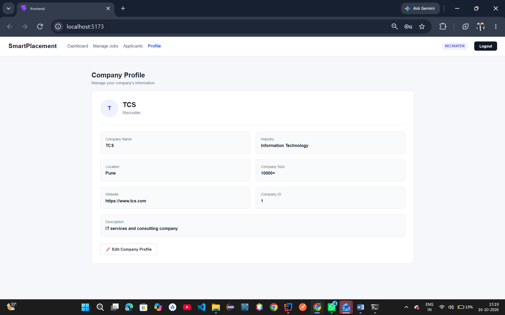

### 💼 Job Manager

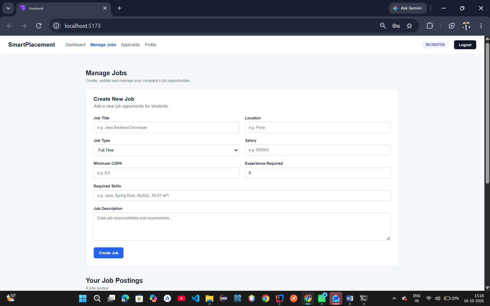

### 💼 Apllication Status

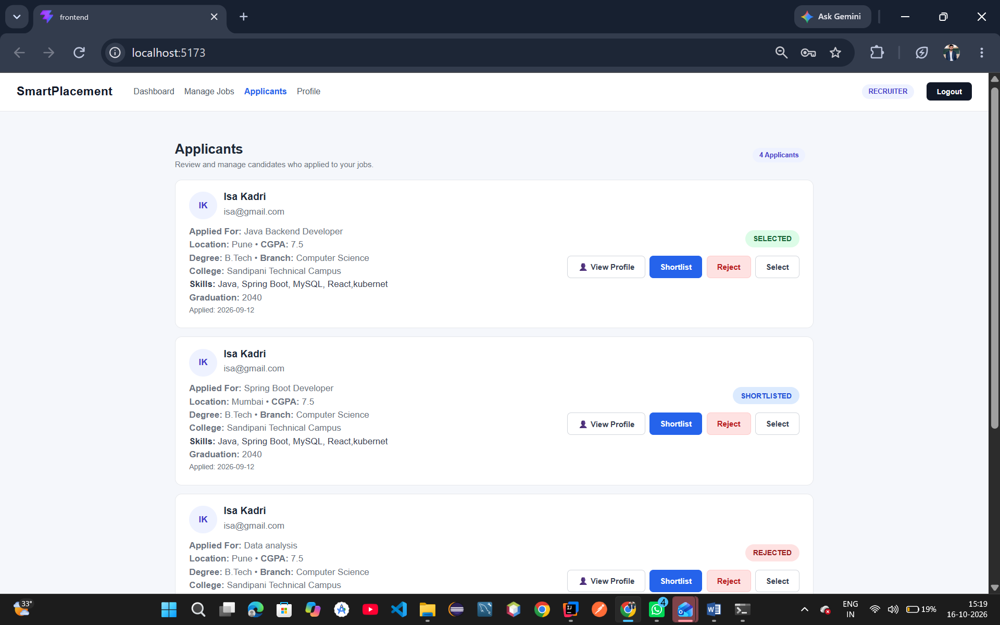

### 💼 Job Listings Recruiter

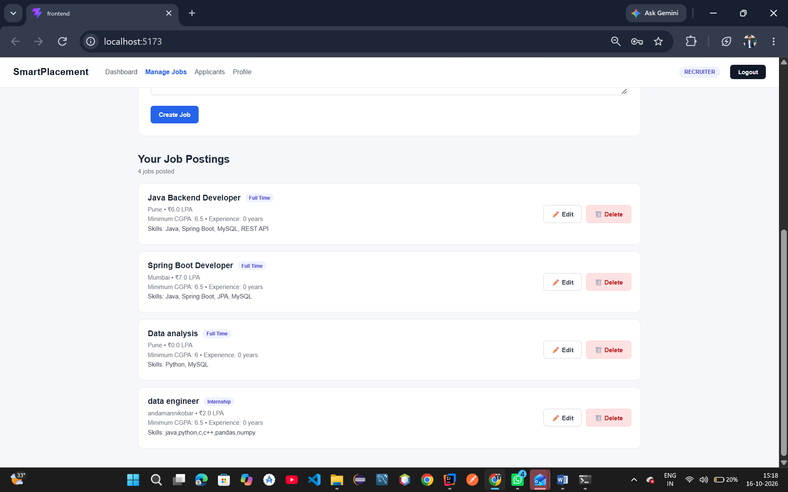


---

## 🛠️ Technology Stack

| Layer | Technologies |
|-------|--------------|
| 🎨 Frontend | React, Vite, JavaScript, CSS |
| ⚙️ Backend | Java, Spring Boot, REST APIs |
| 🔐 Security | Spring Security, JWT, BCrypt, RBAC |
| 🐬 Database | MySQL |
| 🤖 AI | External AI provider API (Gemini key configurable) |
| 📦 Build Tools | Maven, npm |
| 🧪 API Testing | Postman |

---

## 🏗️ Architecture

The backend follows a layered architecture, and the frontend talks to it over HTTP/JSON with a JWT.

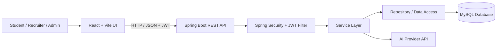

### Request Flow

```text
React Page
 ↓
Service (api.js)
 ↓
Controller
 ↓
Service Layer
 ↓
Repository (JPA)
 ↓
MySQL
 ↓
Service Layer
 ↓
Controller (JSON)
 ↓
React Page
```

### Typical User Journey

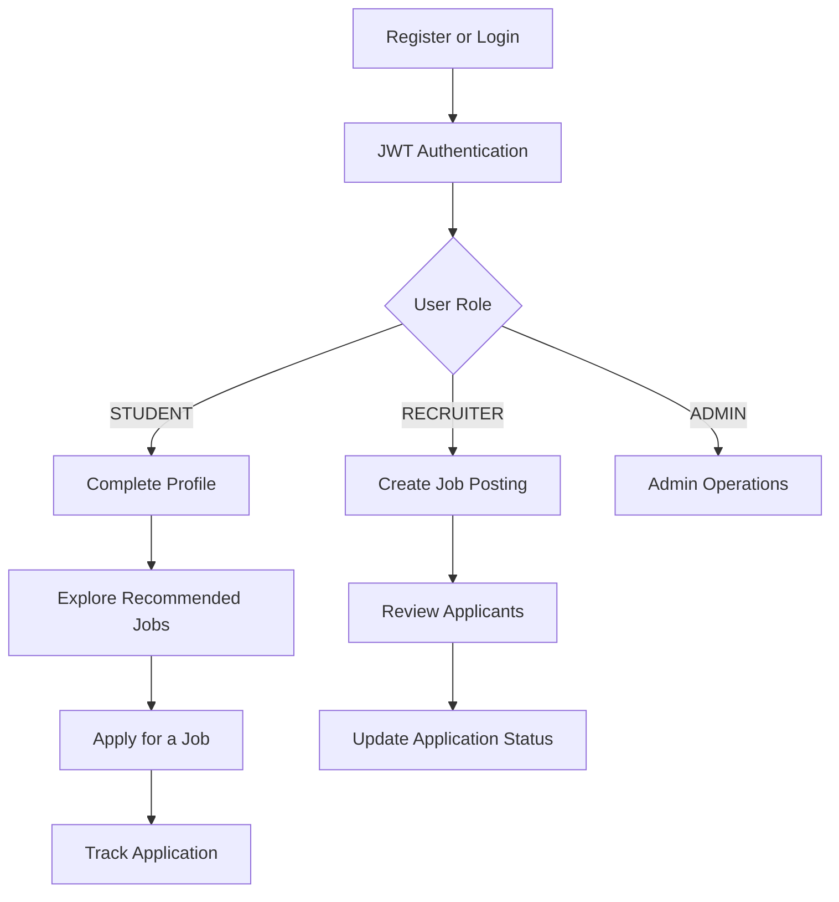

---

## 📂 Project Structure

```text
smart-placement-platform/
│
├── README.md
├── .gitignore
├── LICENSE
├── .env.example
│
├── docs/
│   ├── architecture.md
│   ├── database-design.md
│   └── screenshots/
│       ├── login.png
│       ├── student-dashboard.png
│       ├── recruiter-dashboard.png
│       ├── jobs.png
│       └── interview-coach.png
│
├── frontend/
│   ├── package.json
│   ├── index.html
│   ├── vite.config.js
│   ├── .env.example
│   ├── public/
│   └── src/
│       ├── main.jsx
│       ├── App.jsx
│       ├── components/
│       │   ├── Navbar.jsx
│       │   ├── Sidebar.jsx
│       │   ├── ProtectedRoute.jsx
│       │   ├── Loading.jsx
│       │   └── ErrorMessage.jsx
│       ├── pages/
│       │   ├── Login.jsx
│       │   ├── Register.jsx
│       │   ├── StudentDashboard.jsx
│       │   ├── RecruiterDashboard.jsx
│       │   ├── AdminDashboard.jsx
│       │   ├── StudentProfile.jsx
│       │   ├── Jobs.jsx
│       │   ├── JobDetails.jsx
│       │   ├── Applications.jsx
│       │   ├── ResumeBuilder.jsx
│       │   ├── JobRecommendations.jsx
│       │   └── InterviewCoach.jsx
│       ├── services/
│       │   ├── api.js
│       │   ├── authService.js
│       │   ├── jobService.js
│       │   ├── applicationService.js
│       │   └── interviewService.js
│       ├── context/
│       │   └── AuthContext.jsx
│       ├── hooks/
│       │   └── useAuth.js
│       └── utils/
│           ├── constants.js
│           └── validators.js
│
├── backend/
│   ├── pom.xml
│   ├── mvnw / mvnw.cmd
│   └── src/main/
│       ├── java/smart_placement_platform/backend/
│       │   ├── PlacementApplication.java
│       │   ├── config/          → SecurityConfig
│       │   ├── security/        → JwtAuthenticationFilter, JwtService,
│       │   │                      CustomUserDetailsService
│       │   ├── auth/            → AuthController, AuthService, dto/
│       │   ├── student/         → Controller, Service, Repository, StudentProfile
│       │   ├── recruiter/       → Controller, Service, Repository
│       │   ├── job/             → Controller, Service, Repository, Job
│       │   ├── application/     → Controller, Service, Repository, JobApplication
│       │   ├── resume/
│       │   ├── recommendation/
│       │   ├── interview/       → InterviewController, InterviewService
│       │   ├── user/            → User, UserRepository
│       │   └── exception/
│       └── resources/
│           ├── application.properties
│           └── application-example.properties
│
└── database/
    ├── schema.sql
    └── sample-data.sql
```

---

## 🗄️ Database Design

The project uses MySQL as its relational database.

```sql
CREATE DATABASE placement_platform;
```

### Core Entities

```text
┌───────────────┐
│     users     │  (STUDENT / RECRUITER / ADMIN)
└───────┬───────┘
        │
   ┌────┴─────────────┐
   ▼                  ▼
┌──────────────┐  ┌──────────────┐
│student_profile│  │  recruiter   │
└──────┬───────┘  └──────┬───────┘
       │                 │ posts
       │                 ▼
       │          ┌──────────────┐
       │          │     jobs     │
       │          └──────┬───────┘
       │                 │
       └──────┬──────────┘
              ▼
     ┌──────────────────┐
     │ job_applications │
     └──────────────────┘
```

| Entity | Purpose |
|--------|---------|
| `users` | Login credentials and role |
| `student_profile` | Education, CGPA, skills, graduation details |
| `recruiter` | Recruiter / company information |
| `jobs` | Job openings posted by recruiters |
| `job_applications` | Student applications and their status |

> Table names are illustrative. Match them to your `schema.sql`.

---

## 🔐 Security

### Password Hashing

Passwords are hashed with BCrypt before storage. Plain-text passwords are never saved.

### JWT Authentication

```text
          HTTP Request + Bearer Token
                      │
                      ▼
           ┌─────────────────────┐
           │ JwtAuthenticationFilter │
           └──────────┬──────────┘
                      │
                Valid Token?
                 /        \
               YES         NO
                │           │
                ▼           ▼
        Role Check      401 Unauthorized
                │
        Allowed for Role?
           /        \
         YES         NO
          │           │
          ▼           ▼
     Controller   403 Forbidden
```

### Security Notes

- Never commit database passwords, API keys, JWT secrets or real user data
- Store secrets in environment variables or untracked local config
- Validate requests and enforce authorization on the backend
- For production, configure HTTPS, CORS, logging and secure secret management
- AI API quotas and rate limits depend on the provider and plan

---

## ⚙️ Installation

### Prerequisites

- JDK compatible with the backend's configured Java version
- Node.js and npm
- MySQL Server
- Git
- Maven (or the included Maven Wrapper)

### 1. Clone The Repository

```bash
git clone https://github.com/isakadri/smart-placement-platform.git
cd smart-placement-platform
```

### 2. Create Database

```sql
CREATE DATABASE placement_platform;
```

Then run `database/schema.sql` (and optionally `database/sample-data.sql`).

### 3. Configure Environment Variables

```env
DB_USERNAME=your_mysql_username
DB_PASSWORD=your_mysql_password
GEMINI_API_KEY=your_ai_provider_key
```

Backend datasource configuration:

```properties
spring.datasource.url=jdbc:mysql://localhost:3306/placement_platform
spring.datasource.username=${DB_USERNAME}
spring.datasource.password=${DB_PASSWORD}
```

> Do not commit your real credentials or API keys to GitHub. Use the exact variable names your backend expects.

### 4. Run The Backend

```bash
cd backend

# Windows PowerShell
.\mvnw.cmd spring-boot:run

# macOS / Linux
./mvnw spring-boot:run

# Or with Maven installed
mvn spring-boot:run
```

The API typically runs at `http://localhost:8080`.

### 5. Run The Frontend

```bash
cd frontend
npm install
npm run dev
```

Open the URL printed by Vite (usually `http://localhost:5173`).

---

## 🧪 Testing Flow

```text
1. Register a Student
      ↓
2. Login
      ↓
3. Complete Student Profile
      ↓
4. Browse Jobs & Check Eligibility
      ↓
5. Apply for a Job
      ↓
6. Verify Application Status
      ↓
7. Login as Recruiter
      ↓
8. Post a Job / Review Applicants
      ↓
9. Update Application Status
      ↓
10. Verify Role Restrictions
      ↓
11. Test AI Interview Coach
```

Use Postman or another API client to test REST endpoints and authorization behavior. Test AI features only after configuring the provider key.

---

## 🧩 Main Modules

### Student Module

Registration • Login • Profile • Job Search • Eligibility Check • Apply • Application Tracking • Resume Builder • Job Recommendations • Interview Coach

### Recruiter Module

Company Profile • Post Jobs • Manage Jobs • View Applicants • Update Application Status

### Admin Module

User Oversight • Platform Access Control

---

## 🎯 Project Objectives

- Build a centralized placement platform for students and recruiters
- Make job discovery and application tracking simple
- Help students prepare for interviews using AI
- Enforce role-based access across the whole stack
- Practice building a production-style Java Full Stack application

---

## 🗺️ Roadmap

- [ ] 📊 Placement analytics dashboard with charts
- [ ] 🔔 In-app notifications for application status changes
- [ ] 📧 Email notifications for interview schedules
- [ ] 🗓️ Application timeline and interview scheduling
- [ ] 📝 More detailed AI resume feedback
- [ ] 💻 Coding assessments for applicants
- [ ] 🧪 Automated backend and frontend tests
- [ ] 🐳 Docker-based development and deployment
- [ ] ☁️ Production cloud deployment

---

## 🧠 Learning Outcomes

This project provided practical experience with:

- Spring Boot REST API development
- Spring Security and JWT authentication
- Role-Based Access Control (RBAC)
- BCrypt password hashing
- Layered architecture (Controller → Service → Repository)
- MySQL schema design and relationships
- React with Vite, routing and protected routes
- Context API for authentication state
- Frontend–backend integration with Axios/fetch
- Integrating a third-party AI API
- Environment-based secret management

---

## 👨‍💻 Author

<div align="center">

**Isa Abdul Kadri**

B.Tech Computer Science Engineering
Sandipani Technical Campus

<p>
  <a href="https://github.com/isakadri">GitHub</a> •
  <a href="https://www.linkedin.com/in/isa-kadri-767a6234b/">LinkedIn</a>
</p>

<p>
  <code>Java</code>
  <code>Spring Boot</code>
  <code>React</code>
  <code>Vite</code>
  <code>MySQL</code>
  <code>JWT</code>
  <code>REST API</code>
</p>

</div>

---

## ⭐ Support

If you find this project useful, consider giving the repository a ⭐.

<div align="center">

### 🚀 Smart Placement Platform

*Making campus placement workflows more organized and accessible.*

</div>

---

## 📄 License

This project was developed for educational and portfolio purposes.
