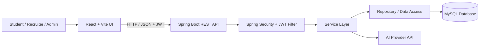
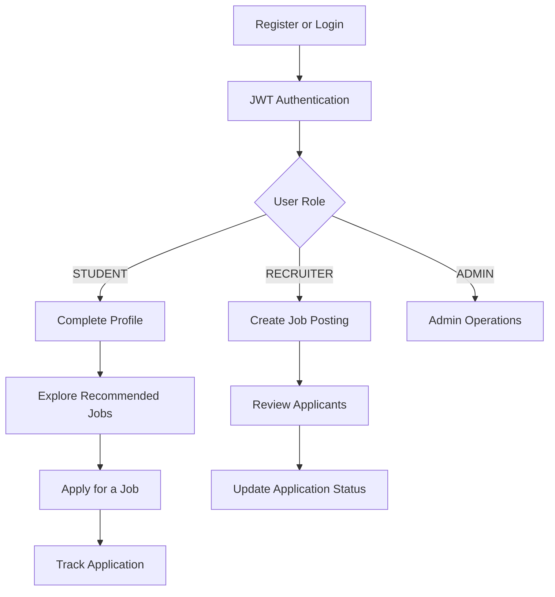

:: {align="center"}
# 🚀 Smart Placement Platform

### An AI-powered placement management platform connecting students, recruiters, and administrators.

**Discover opportunities · Manage applications · Prepare for
interviews**
:::📌 Overview
Smart Placement Platform is a Java Full Stack web application
designed to organize the campus placement journey in one place. Students
can maintain profiles, explore eligible job opportunities, apply for
jobs, and prepare for interviews. Recruiters can publish job openings
and manage applications, while administrators can oversee platform
access.
The application uses a React + Vite frontend, a Spring Boot REST
API, and a MySQL database. Authentication uses JWT, and
passwords are protected with BCrypt.
💡 Project goal: Make placement activities easier to track by
giving students and recruiters a single, role-aware platform.

✨ Features
<table>
<tr>
<td width="50%">
👨‍🎓 Student Workspace
- Student profile with education, CGPA, skills, and graduation details
- Browse jobs and check eligibility
- Apply for jobs and track application status
- Resume builder and resume-to-job matching
- Job recommendations based on profile information
</td>
<td width="50%">
🏢 Recruiter Workspace
- Recruiter/company profile
- Post and manage job openings
- Review applications and candidate information
- Support a student-to-recruiter placement workflow
</td>
</tr>
<tr>
<td width="50%">
🤖 AI Interview Assistance
- Generate interview practice questions
- Practice Java Full Stack topics
- AI chat-style interview coach where configured
</td>
<td width="50%">
🔐 Security
- JWT-based authentication
- BCrypt password hashing
- Role-Based Access Control (RBAC)
- Separate access for STUDENT, RECRUITER, and ADMIN
</td>
</tr>
</table>
🧰 Technology Stack
  Layer         Technologies
  Frontend      React, Vite, JavaScript, CSS
  Backend       Java, Spring Boot, REST APIs
  Security      Spring Security, JWT, BCrypt, RBAC
  Database      MySQL
  Build tools   Maven, npm
  API testing   Postman (recommended)
🏗️ Architecture

Typical user journey

🖼️ Screenshots
Add screenshots from your running application to the repository so
visitors can see the actual UI. Suggested files:
docs/
└── screenshots/
    ├── login.png
    ├── student-dashboard.png
    ├── jobs.png
    ├── resume-builder.png
    ├── interview-coach.png
    └── recruiter-dashboard.png
Once you add those real screenshots, display them in the README like
this:

Screenshot placeholders are suggestions, not fabricated images. Commit
screenshots of the real running application to make this section
visual.

⚙️ Getting Started
Prerequisites
- JDK compatible with the backend's configured Java version
- Node.js and npm
- MySQL Server
- Git
- Maven, or the Maven Wrapper if included
1. Clone the repository
git clone https://github.com/YOUR-USERNAME/smart-placement-platform.git
cd smart-placement-platform
Replace YOUR-USERNAME with your GitHub username and use your actual
repository URL.
2. Configure MySQL
Create the database:
CREATE DATABASE placement_platform;
Update the backend database configuration with your local MySQL username
and password. Example settings (adjust to your existing configuration):
spring.datasource.url=jdbc:mysql://localhost:3306/placement_platform
spring.datasource.username=${DB_USERNAME}
spring.datasource.password=${DB_PASSWORD}
3. Configure environment variables
Configure database credentials and any AI-provider key required by
interview features. Never commit real credentials or API keys.
DB_USERNAME=your_mysql_username
DB_PASSWORD=your_mysql_password
GEMINI_API_KEY=your_ai_provider_key
Use the exact environment variable/property names expected by your
backend configuration.
4. Run the backend
From the backend directory, if the Maven Wrapper is included:
Windows PowerShell
.\mvnw.cmd spring-boot:run
Or with Maven installed
mvn spring-boot:run
The API commonly runs at http://localhost:8080.
5. Run the frontend
In another terminal:
cd frontend
npm install
npm run dev
Open the local URL printed by Vite (often http://localhost:5173).
If your repository uses different folder names or scripts, follow the
actual project structure and package.json.

🔑 Authentication and Roles
After login, the frontend stores a JWT and sends it with protected API
requests.
  Role                                Intended access
  STUDENT                           Profile, job discovery,
                                      applications, resume tools,
                                      interview practice
  RECRUITER                         Recruiter profile, job posting,
                                      applicant management
  ADMIN                             Administrative operations and
                                  platform oversight
RBAC means API access is restricted according to the authenticated
user's role. The backend must enforce these checks; hiding a frontend
button alone is not security.
🧪 Testing Checklist
1. Register a student and log in.
2. Complete the student profile.
3. Browse jobs and check eligibility.
4. Apply for a job and verify the application status.
5. Log in as a recruiter and test job/application management.
6. Verify users cannot access endpoints outside their assigned roles.
7. Test AI interview features after configuring the provider key and
   quota.
Use Postman or another API client to test REST endpoints and
authorization behavior.
🔒 Security Notes
- Never commit database passwords, API keys, JWT signing secrets, or
  real user data.
- Store secrets in environment variables or local untracked
  configuration.
- Use BCrypt for password hashing; never store plain-text passwords.
- Validate requests on the backend and enforce authorization at the
  API layer.
- For production, configure HTTPS, CORS, logging, input validation,
  and secure secret management.
- AI API quotas and rate limits depend on the provider and plan.
🗺️ Roadmap
- [ ] Placement analytics dashboard with charts
- [ ] In-app notifications for application status changes
- [ ] Email notifications for interview schedules
- [ ] Application timeline and interview scheduling
- [ ] More detailed AI resume feedback
- [ ] Coding assessments for job applicants
- [ ] Automated backend and frontend tests
- [ ] Docker-based development and deployment
- [ ] Production cloud deployment
📁 Suggested Repository Layout
smart-placement-platform/
├── backend/
│   ├── src/
│   ├── pom.xml
│   └── ...
├── frontend/
│   ├── src/
│   ├── package.json
│   └── ...
├── docs/
│   └── screenshots/
├── .gitignore
└── README.md
This is an illustrative layout; keep folder names aligned with your
actual repository.
👨‍💻 Author
Isa Abdul Kadri · B.Tech Computer Science
- GitHub: https://github.com/YOUR-USERNAME
- LinkedIn: https://www.linkedin.com/in/YOUR-LINKEDIN-PROFILE/
Replace these placeholders with your actual profile links.
📄 License
This is currently a portfolio/academic project. If you intend to
distribute or reuse it publicly, add a license (for example, MIT) and
include a LICENSE file.
::: {align="center"}
**Built to make campus placement workflows more organized and
accessible.** 🚀
:::
